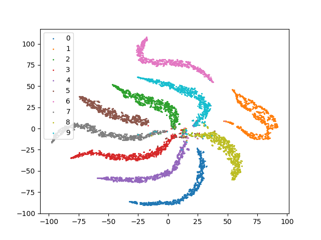
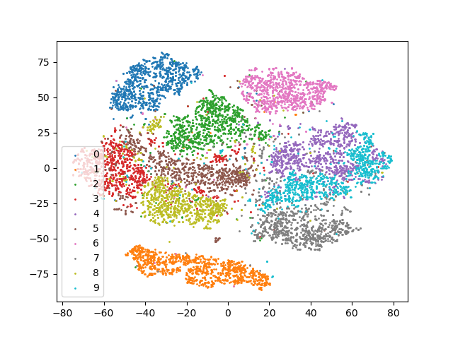
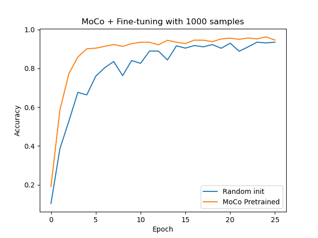

# Contrastive Representation Learning

Learning image representations on MNIST by contrasting positives against negatives: from a label-supervised pairwise loss, through InfoNCE and SimCLR, to Momentum Contrast (MoCo), evaluated with linear probes, t-SNE and low-label fine-tuning.

---

## Theory

Please note that the theory corresponding to the codes is hosted on this [page](https://parag1604.github.io/notes/Machine-Learning/Self-Supervised-Representation-Learning#from-energy-to-contrast) (Self-Supervised Representation Learning: InfoNCE from energies, supervised contrastive learning, SimCLR, MoCo, and non-contrastive methods).

## Python Environment Setup

Python >= 3.10. Install the dependencies with

```bash
pip install -r requirements.txt
```

A GPU (CUDA) or Apple Silicon (MPS) is used automatically if available; everything also runs on the CPU, only slower.

## Data

MNIST is downloaded automatically by torchvision into `./data` on the first run (change it with `--data <folder>`).

## Running

Each file adds one idea to the previous one. Shared code (data, augmentation, `Encoder`, `Classifier`, linear probe, t-SNE) is in `utils.py`. Every training script ends by saving a t-SNE plot of the test-set embeddings to `outputs/tsne_<version>.png` and printing the accuracy of a linear probe (a linear classifier trained on top of the frozen encoder). Every script has `--help`; the "quick" commands are for checking that things run, not for good results.

### version0: pairs of "same" and "different"

```bash
python version0.py          # quick: python version0.py --iters 200
```

For each anchor image, a positive (another image of the same digit) and a negative (a different digit) are sampled using the labels. The dot product of two embeddings is used as the logit of "same digit?", trained with binary cross-entropy.

A t-SNE of the test embeddings from the original version of this script:



The embeddings are not normalised, so classes spread out radially along rays from the origin.

### version1: InfoNCE, one positive against many negatives

```bash
python version1.py          # quick: python version1.py --iters 200
```

Each anchor now competes against every positive in the batch through a softmax over cosine similarities divided by a temperature `--tau`: this is the InfoNCE loss. Positives are still picked with labels, and same-digit "negatives" are masked out.

### version2: self-supervised, SimCLR

```bash
python version2.py          # quick: python version2.py --epochs 1 --max-batches 50
```

No labels during training. The positive is a second random augmentation (rotation and crop) of the same image, and the other images in the batch are the negatives. The labels are used only for the evaluation.

### version3: Momentum Contrast (MoCo)

```bash
python version3.py          # quick: python version3.py --epochs 1 --max-batches 50
```

Negatives come from a queue of keys from the last `--history` batches, produced by a momentum encoder that slowly follows the trained encoder (`--m 0.999`, `--tau 0.07`). This gives many negatives without a large batch. The momentum encoder is saved to `checkpoints/moco_encoder.pth` (created by training, not shipped with the repo). Add `--test-every N` to run the linear probe every N epochs.

A t-SNE of the test embeddings from the original MoCo run:



### version4: fine-tuning with 1000 labels

```bash
python version4.py          # needs checkpoints/moco_encoder.pth from version3
```

Only 1000 labelled training images are used. The encoder and a linear classifier are fine-tuned starting from (a) a random initialisation and (b) the MoCo encoder, and both test-accuracy curves are plotted to `outputs/finetune.png`. From the original run:



The pretrained encoder starts higher, gets above 90% within about 4 epochs, and stays ahead of the randomly initialised one (about 95% vs 93% after 25 epochs).
